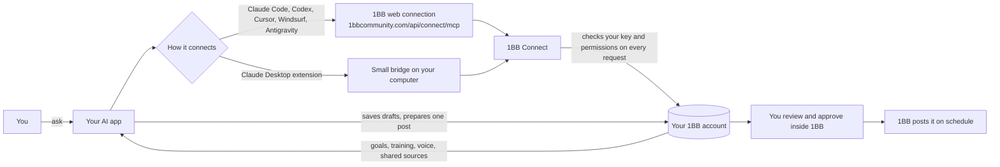

# 1BB Connect plugins

Plug your 1BB account into the AI you already use: Claude Code, Codex, Claude Desktop, Cursor, Windsurf or Antigravity.

**The short version:** you make a connection key inside 1BB. You put that key on your own computer, never in a chat. Your AI then reads the parts of 1BB you picked, and it can save drafts to your 1BB Library. You still approve every post yourself, inside 1BB.

## What your AI can and can't do

| Your AI CAN | Your AI CAN'T |
| --- | --- |
| Read your business brief | Approve, schedule or publish a post |
| Read your goals (read only) | Change your goals or training progress |
| Search and read 1BB training | See other members, staff records or your personal notes |
| Read a safe summary of your Voice DNA | See sources you did not share |
| Search sources you chose to share | Spend money on images or video |
| List and read your Library | See your password |
| Save drafts and edit unapproved draft captions | Do anything you did not tick when you made the key |
| Prepare one post and hand you a review link | Post for you. You approve inside 1BB. |

## How it works



Diagram source: [docs/diagrams/connect-flow.mmd](docs/diagrams/connect-flow.mmd).

Think of the key like a visitor badge. 1BB checks the badge at the door every single time, and the badge only opens the rooms you picked.

## Step 1: Make your key (everyone)

1. Open [1bbcommunity.com/dashboard/settings/connect](https://1bbcommunity.com/dashboard/settings/connect).
2. Tick only what you want your AI to use (for example goals, training, Voice DNA, drafts).
3. Create the key and press **Copy**. It starts with `1bbct_`.

**Your key lasts 7 days.** After that it stops working and you make a new one. If you lose a key or paste it somewhere by mistake, revoke it on the same page and make a new one.

**Never paste your key into a chat.** Not with your AI, not in email, not in a screenshot.

## Step 2: Put your key on your computer

Most AI apps read the key from a setting on your computer called `ONEBB_CONNECTION_TOKEN`. Claude Desktop is different, it has its own box (skip to the Claude Desktop section).

### Mac

Copy your key in 1BB first. Then open the **Terminal** app and paste these lines one at a time, pressing Enter after each:

```sh
mkdir -p ~/.1bb && pbpaste > ~/.1bb/connection-token && chmod 600 ~/.1bb/connection-token && pbcopy < /dev/null
```

That saves the key in a private file and clears your clipboard. The key never shows on screen.

One time only, so Terminal always loads it:

```sh
echo 'export ONEBB_CONNECTION_TOKEN="$(cat ~/.1bb/connection-token 2>/dev/null)"' >> ~/.zshrc
```

For apps you open from the Dock (Cursor, Windsurf, Antigravity, the Codex app):

```sh
launchctl setenv ONEBB_CONNECTION_TOKEN "$(cat ~/.1bb/connection-token)"
```

Then fully quit and reopen that app. Run this line again after you restart your Mac.

### Windows

Copy your key in 1BB first. Open **PowerShell** and paste:

```powershell
[Environment]::SetEnvironmentVariable("ONEBB_CONNECTION_TOKEN", (Get-Clipboard).Trim(), "User"); Set-Clipboard -Value " "
```

Then close and reopen your AI app and any terminal windows.

## Claude Code

Claude Code gets the full plugin: the 1BB tools plus three ready-made playbooks.

1. Do Step 1 and Step 2, then open a new Terminal window.
2. Start Claude Code (`claude`) and type:

```text
/plugin marketplace add 1-Button-Business/1bb-connect-plugins
/plugin install 1bb@1bb-connect
```

3. Quit Claude Code and start it again.
4. Type `/mcp`. You should see `1bb` connected.
5. Try it: "Check my 1BB connection."

## Codex

Codex also gets the full plugin with the three playbooks.

1. Do Step 1 and Step 2, then open a new Terminal window.
2. Run:

```sh
codex plugin marketplace add 1-Button-Business/1bb-connect-plugins
codex plugin add 1bb@1bb-connect
```

Or open Codex, type `/plugins`, pick **1BB Connect** and install it.

3. Run `codex mcp list`. You should see `1bb` with `ONEBB_CONNECTION_TOKEN`.
4. Try it: "Plan my day from my 1BB goals and training."

**Codex fallback (tools only, no playbooks).** Add this to `~/.codex/config.toml` (also in [configs/codex-config.toml](configs/codex-config.toml)):

```toml
[mcp_servers.onebb]
url = "https://1bbcommunity.com/api/connect/mcp"
bearer_token_env_var = "ONEBB_CONNECTION_TOKEN"
```

## Claude Desktop

Claude Desktop uses an extension file, `1bb-connect.mcpb`. You do not need Step 2.

1. Get `1bb-connect.mcpb` from Drey.
2. Open Claude Desktop, go to **Settings**, then **Extensions**, and drag the file in (or double-click the file).
3. Click **Install**. Paste your key into the **1BB connection key** box. Claude stores it in your computer's secure keychain.
4. Turn the extension on, then fully quit and reopen Claude Desktop.
5. Try it: "Check my 1BB connection."

Every 7 days: Settings, then Extensions, then 1BB Connect, then paste your new key.

The extension needs Node.js 22 or newer. If Claude says Node is missing or too old, install the current LTS from [nodejs.org](https://nodejs.org) and reopen Claude.

## Cursor

1. Do Step 1 and Step 2 (Mac users: run the `launchctl` line, then reopen Cursor).
2. Open Cursor Settings, then **MCP**, then **Add new global MCP server**. That opens `~/.cursor/mcp.json`.
3. Paste this (also in [configs/cursor-mcp.json](configs/cursor-mcp.json)) and save:

```json
{
  "mcpServers": {
    "1bb": {
      "url": "https://1bbcommunity.com/api/connect/mcp",
      "headers": {
        "Authorization": "Bearer ${env:ONEBB_CONNECTION_TOKEN}"
      }
    }
  }
}
```

4. Back in MCP settings, `1bb` should show a green dot.

If you already have other servers in that file, add only the `"1bb": { ... }` part inside your existing `mcpServers`.

## Windsurf and Antigravity

Same idea as Cursor, but these apps call the address `serverUrl`.

- Windsurf: edit `~/.codeium/windsurf/mcp_config.json`.
- Antigravity: open the MCP servers panel, choose to view the raw config, and edit it there.

Paste this (also in [configs/windsurf-antigravity-mcp_config.json](configs/windsurf-antigravity-mcp_config.json)):

```json
{
  "mcpServers": {
    "1bb": {
      "serverUrl": "https://1bbcommunity.com/api/connect/mcp",
      "headers": {
        "Authorization": "Bearer ${env:ONEBB_CONNECTION_TOKEN}"
      }
    }
  }
}
```

Any other AI app that takes a web address plus headers for MCP works the same way: the address above, and the header `Authorization: Bearer <your key>` read from `ONEBB_CONNECTION_TOKEN`.

## The three playbooks (Claude Code and Codex)

| Say this | What happens |
| --- | --- |
| "Plan my day from my 1BB goals" | Reads your goals, training and drafts, then gives you a top 3, one training to watch and one content move |
| "Write a LinkedIn post in my voice and save it" | Uses your Voice DNA, saves a draft to your Library, tells you it is not posted |
| "Turn my 1BB source about pricing into a carousel" | Finds the source, writes it in your voice, saves a draft linked to that source |

Every playbook checks your connection first, lists the 1BB data it used, tells you what business info is missing, and never says something was posted when it was not.

## Every 7 days

1. Make a new key in 1BB (Step 1).
2. Mac: run the `pbpaste` line from Step 2, then the `launchctl` line if you use Cursor, Windsurf, Antigravity or the Codex app. Windows: run the PowerShell line again.
3. Claude Desktop: paste the new key in the extension settings.
4. Reopen your AI app.

## Troubleshooting

| What you see | What to do |
| --- | --- |
| "1BB Connect could not start" (Claude Desktop) | Your key is wrong or expired. Make a new key and paste it in the extension settings. |
| `1bb` shows "Failed to connect" or 401 | Key missing or expired. Redo Step 1 and Step 2, then reopen the app. |
| 503 "not configured" | 1BB Connect is not switched on yet. Nothing is wrong on your side. |
| 403 | You are using a browser-based tool. 1BB blocks those on purpose. Use a desktop app from this guide. |
| A tool is missing | You did not tick that permission. Make a new key with it ticked. |
| Cursor or Windsurf cannot see the key | Mac: run the `launchctl` line, then fully quit and reopen the app. Some app versions do not read `${env:...}` in headers; check the app's MCP log. |

## For Drey: maintaining this repo

### What is in here

```text
.claude-plugin/marketplace.json      Claude Code marketplace (lists plugin "1bb")
.agents/plugins/marketplace.json     Codex marketplace (same plugin folder)
plugins/1bb/
  .claude-plugin/plugin.json         Claude Code manifest
  .mcp.json                          Claude Code MCP: remote http + Bearer ${ONEBB_CONNECTION_TOKEN}
  .codex-plugin/plugin.json          Codex manifest (skills + mcpServers + interface)
  .codex-mcp.json                    Codex MCP: remote http + bearer_token_env_var
  skills/plan-my-day | write-in-my-voice | source-to-content
claude-desktop/
  manifest.json                      .mcpb manifest (key is a sensitive user_config field)
  server/connect.mjs                 prebuilt stdio bridge (copied, not edited)
configs/                             Codex config.toml, Cursor, Windsurf/Antigravity snippets
scripts/validate.ts                  offline checks for every manifest and config
scripts/smoke-bridge.ts              starts the bridge with FAKE keys, expects a clean refusal
docs/diagrams/connect-flow.mmd       flow diagram source
```

### Checks

Needs Node 22.18 or newer (runs TypeScript directly, no install step).

```sh
npm run validate        # 64 offline checks
npm run validate:mcpb   # official mcpb schema check (@anthropic-ai/mcpb pinned to 2.1.2)
npm run pack:mcpb       # builds dist/1bb-connect.mcpb
npm run smoke           # fake-key refusal test, offline
npm run smoke -- --network   # adds one random well-formed fake key against the live API
claude plugin validate .            # Claude Code marketplace
claude plugin validate plugins/1bb  # Claude Code plugin
```

### Why it is built this way

- **One plugin folder for Claude Code and Codex.** Codex reads `.codex-plugin/plugin.json` before `.claude-plugin/plugin.json`, and prefers `.agents/plugins/marketplace.json` over `.claude-plugin/marketplace.json`, so both apps share the same skills without copies.
- **Codex uses the `.codex-plugin` compatibility format, not the newer portable `plugin.json` + `mcp.json`.** The portable format drops any `Authorization` header from the package and expects the key to come from a hosted connection setup. 1BB has no OAuth yet, so the key must come from `ONEBB_CONNECTION_TOKEN`, which the compatibility `.mcp.json` supports through `bearer_token_env_var`. Do not add a root `plugin.json` until 1BB has OAuth; `npm run validate` fails if one appears.
- **Claude Desktop uses the stdio bridge in an .mcpb**, because Claude Desktop's custom web connectors cannot send a fixed bearer header. The bridge talks to `https://fine-cat-456.convex.site` (fixed in the manifest).
- **Bridge bundle provenance:** copied from `1bb-connect-beta/build/packages/connect-beta/dist/connect.mjs` (version 0.2.0), sha256 `d30e0024864fb3f3a16323a44bbe4af7e7529151ae6413c8e29b9f34742b0392`. Rebuild it in the main repo with `npm run connect:build`, copy it in, and update this hash.

### Docs used (checked 2026-10-24)

- Codex plugin packaging and MCP auth: https://developers.openai.com/plugins/build/plugins
- Codex plugins overview: https://developers.openai.com/codex/plugins
- Codex MCP and config.toml (`url`, `bearer_token_env_var`): https://learn.chatgpt.com/docs/extend/mcp and https://learn.chatgpt.com/docs/config-file/config-reference
- Codex source, to confirm plugin MCP parsing: https://github.com/openai/codex (`codex-rs/codex-mcp/src/plugin_config.rs`, `agent_plugin_config.rs`, `codex-rs/core-plugins/src/marketplace.rs`)
- Cursor MCP config interpolation: https://cursor.com/docs/mcp
- Windsurf MCP (`serverUrl`, `${env:...}` in headers): https://docs.devin.ai/windsurf/plugins/cascade/mcp
- MCPB manifest v0.4: https://github.com/anthropics/mcpb

### Not done on purpose

Nothing here is pushed, published or submitted. Publishing the marketplace, sharing the `.mcpb`, or submitting to any plugin directory needs Drey's explicit approval first.
